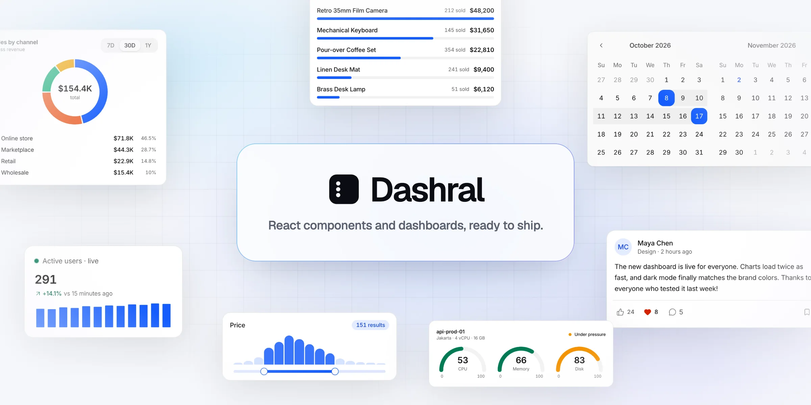
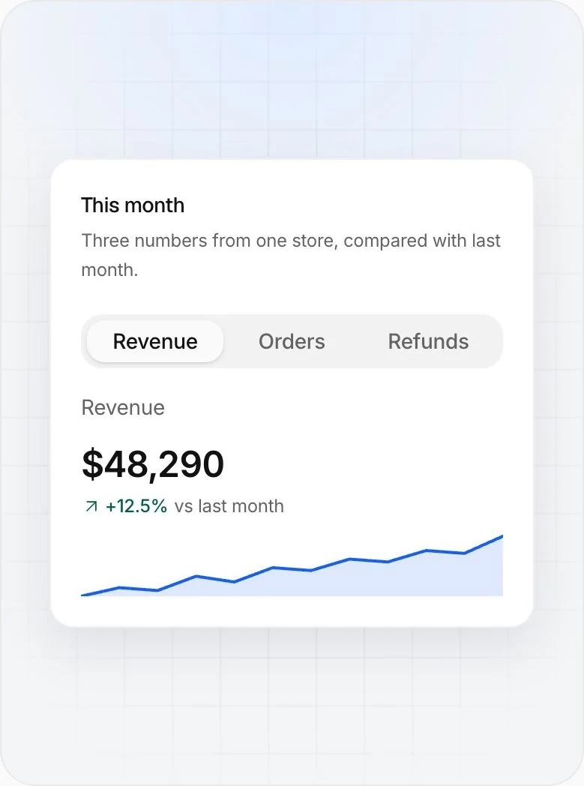
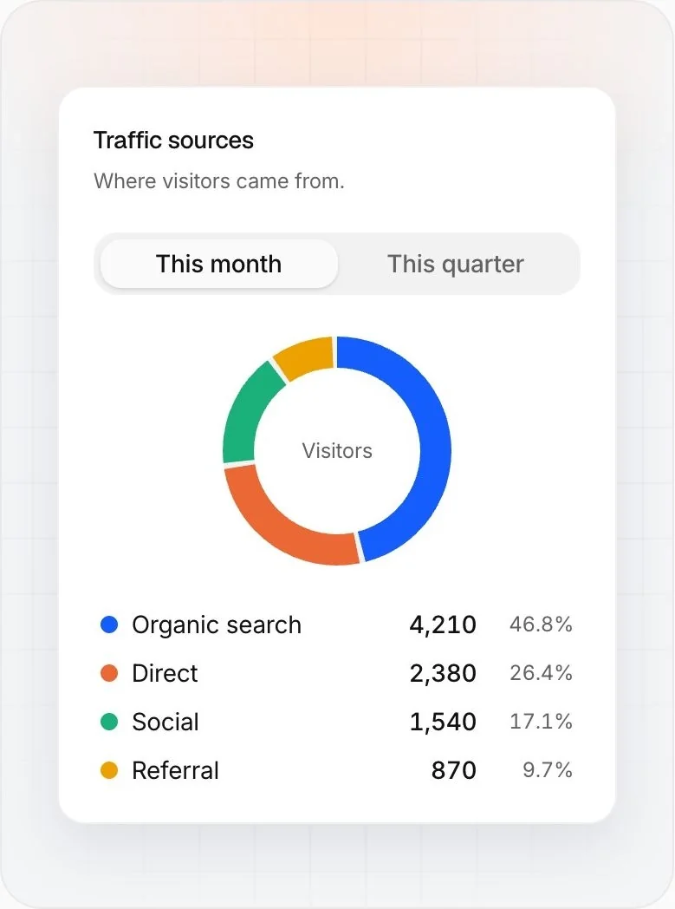
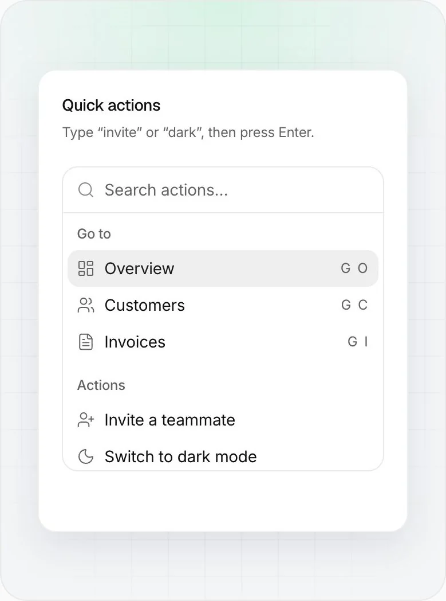
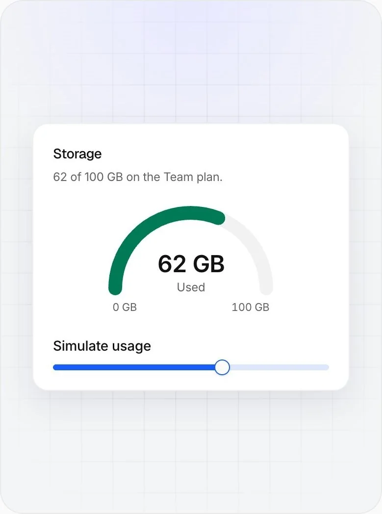
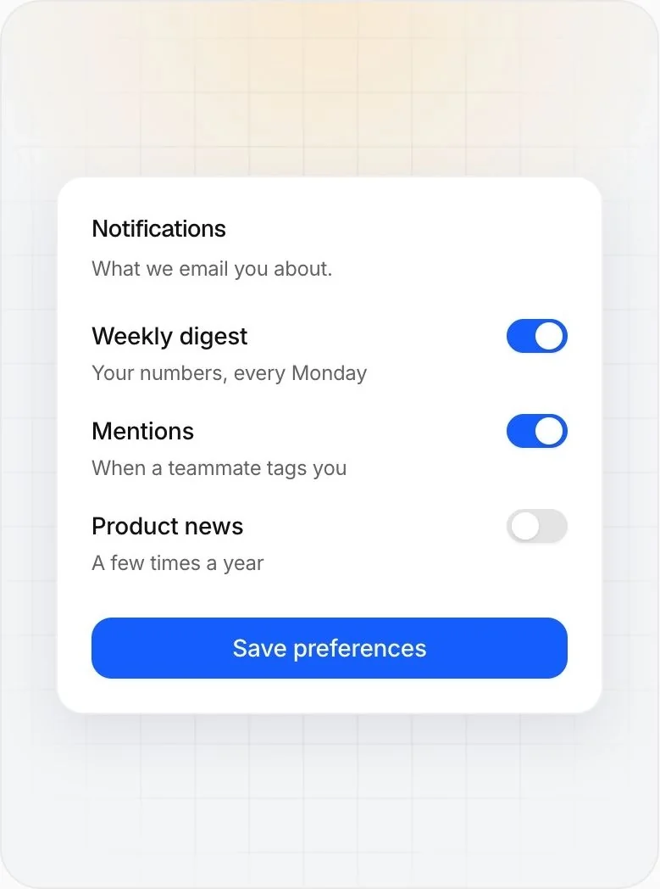
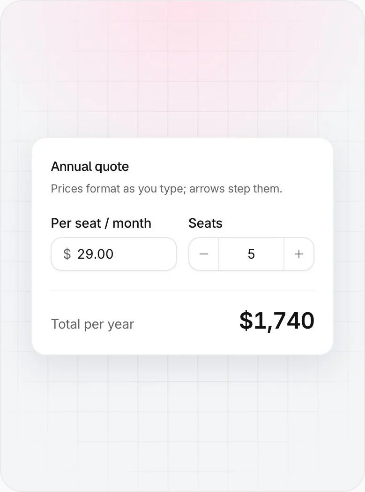
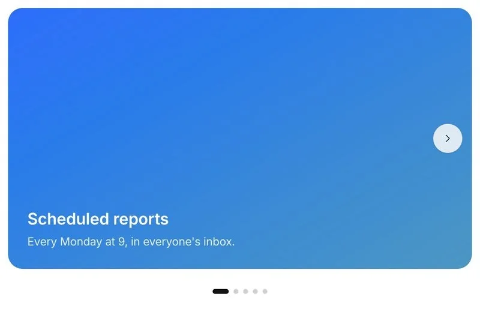
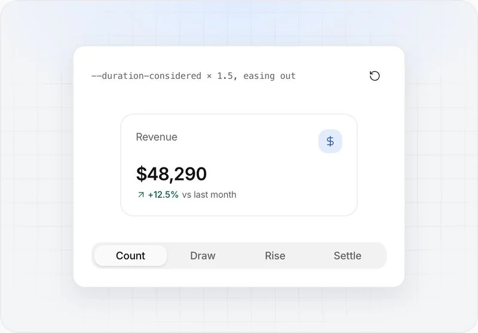

<p align="center">
  <a href="https://dashral.com">
    <picture>
      <source media="(prefers-color-scheme: dark)" srcset="./.github/assets/banner-dark.webp">
      <source media="(prefers-color-scheme: light)" srcset="./.github/assets/banner-light.webp">
      
    </picture>
  </a>
</p>

<p align="center">
  <a href="./LICENSE"></a>
  <a href="https://dashral.com/docs/installation"></a>
  <a href="https://www.npmjs.com/package/@dashral/ui"></a>
  
  
  
  
  
  
</p>

<p align="center">
  <a href="https://demo.dashral.com"><b>Live demo</b></a>
  &nbsp;·&nbsp;
  <a href="https://dashral.com/docs"><b>Docs</b></a>
  &nbsp;·&nbsp;
  <a href="https://dashral.com/components"><b>Components</b></a>
  &nbsp;·&nbsp;
  <a href="https://dashral.com/blocks"><b>Blocks</b></a>
  &nbsp;·&nbsp;
  <a href="https://dashral.com/templates"><b>Templates</b></a>
  &nbsp;·&nbsp;
  <a href="#-getting-started"><b>Install</b></a>
  &nbsp;·&nbsp;
  <a href="https://dashral.com/pricing"><b>Pro</b></a>
</p>

Dashral is a set of accessible React components and blocks, and a Next.js admin dashboard built from them. It's free and open source, and it moves the way good software does: numbers count, lines draw, highlights slide into place. Add any component or block to your project with the shadcn CLI, or start from the dashboard template. Built with Next.js 16, React 19, TypeScript, Tailwind CSS v4 and Radix UI.

## Showcase

Recorded live from [dashral.com](https://dashral.com): the real components, not mockups. Everything here is free and in this repository.

<table>
<tr>
<td width="50%" valign="top">
<a href="https://dashral.com/components/metric-card"><picture>
<source media="(prefers-color-scheme: dark)" srcset="./.github/assets/showcase/metric-card-dark.webp">

</picture></a>
<br><a href="https://dashral.com/components/metric-card"><b>Metric card</b></a><br>
<sub>Switch the metric: the number counts to it and the line draws again.</sub>
</td>
<td width="50%" valign="top">
<a href="https://dashral.com/components/donut-chart"><picture>
<source media="(prefers-color-scheme: dark)" srcset="./.github/assets/showcase/donut-chart-dark.webp">

</picture></a>
<br><a href="https://dashral.com/components/donut-chart"><b>Donut chart</b></a><br>
<sub>Change the period and the arcs grow to the new shares.</sub>
</td>
</tr>
<tr>
<td width="50%" valign="top">
<a href="https://dashral.com/components/command"><picture>
<source media="(prefers-color-scheme: dark)" srcset="./.github/assets/showcase/command-dark.webp">

</picture></a>
<br><a href="https://dashral.com/components/command"><b>Command</b></a><br>
<sub>Type to filter, arrows to move, Enter to run.</sub>
</td>
<td width="50%" valign="top">
<a href="https://dashral.com/components/gauge"><picture>
<source media="(prefers-color-scheme: dark)" srcset="./.github/assets/showcase/gauge-dark.webp">

</picture></a>
<br><a href="https://dashral.com/components/gauge"><b>Gauge</b></a><br>
<sub>Drag the slider: the arc follows and turns amber, then red.</sub>
</td>
</tr>
<tr>
<td width="50%" valign="top">
<a href="https://dashral.com/components/switch"><picture>
<source media="(prefers-color-scheme: dark)" srcset="./.github/assets/showcase/switch-dark.webp">

</picture></a>
<br><a href="https://dashral.com/components/switch"><b>Switch</b></a><br>
<sub>Settings rows with a save button that answers.</sub>
</td>
<td width="50%" valign="top">
<a href="https://dashral.com/components/number-input"><picture>
<source media="(prefers-color-scheme: dark)" srcset="./.github/assets/showcase/number-input-dark.webp">

</picture></a>
<br><a href="https://dashral.com/components/number-input"><b>Number input</b></a><br>
<sub>Step the seats and the total counts to its new value.</sub>
</td>
</tr>
<tr>
<td width="50%" valign="top">
<a href="https://dashral.com/components/carousel"><picture>
<source media="(prefers-color-scheme: dark)" srcset="./.github/assets/showcase/carousel-dark.webp">

</picture></a>
<br><a href="https://dashral.com/components/carousel"><b>Carousel</b></a><br>
<sub>Swipe, drag or step through; several slides per screen if you like.</sub>
</td>
<td width="50%" valign="top">
<a href="https://dashral.com/docs/motion"><picture>
<source media="(prefers-color-scheme: dark)" srcset="./.github/assets/showcase/motion-dark.webp">

</picture></a>
<br><a href="https://dashral.com/docs/motion"><b>Motion</b></a><br>
<sub>Numbers count, lines draw, bars rise, popups settle on a spring.</sub>
</td>
</tr>
</table>

## Contents

- [What's in this repository](#whats-in-this-repository)
- [Getting started](#getting-started)
  - [Start your project](#start-your-project)
- [Project structure](#project-structure)
- [Customization](#customization)
  - [Make it yours](#make-it-yours)
- [Use the components in another project](#use-the-components-in-another-project)
- [Dashral Pro](#dashral-pro)
- [Contributing](#contributing)
- [License](#license)

## What's in this repository

One monorepo: the components, the blocks and a dashboard built from them. Their docs are at [dashral.com](https://dashral.com).

| Part | What it is |
| --- | --- |
| **Components** · [`packages/ui`](packages/ui) | 111 accessible React components: inputs, selects, charts (area, line, bar and more), tables, overlays, a sidebar, seven for AI chat and more. The interactive ones are built on Radix UI. On npm as [`@dashral/ui`](https://www.npmjs.com/package/@dashral/ui). |
| **Motion** · [`packages/motion`](packages/motion) | 31 components with motion/react on top: the same props and look as the kit's, one import to swap, doing what CSS alone can't. Numbers turn on odometer wheels (NumberInput, Badge, Slider's bubble, FunnelChart as its bars glide). Controls answer your hands: drag a Switch's thumb, stretch a Slider past its ends like a rubber band, swipe a Dialog down to close or a Tab to the next, sweep down a list of Checkboxes, hold a Button to confirm (five ways to show the hold). Limits are felt (a strain, a shake, a "Max 50"), toasts fold into a stack that spreads on hover, phones buzz. Menus and Selects spring out of their trigger with one highlight gliding from item to item, Popovers glide to new heights, a Reveal grows in and folds away without cutting a line (a whole list of rows too), a Swap trades what it shows in place, a Glide follows the layout to its new place and size, an ActionBar rises on a spring, Progress glides to each value and shines when done. The Sidebar springs its width as it folds, its current page and hover gliding from row to row; AlertDialog shakes when you click past it; InputOTP pops each character in and ripples when the code is full. A Button with morph changes its text label letter by letter (Follow to Following); Kbd's keys press in as you hold the real ones; ToggleGroup springs one background between its toggles; TimePicker's list glides its highlight and draws its tick. And the rest: Tabs, Accordion, Tooltip, Input, Textarea, SegmentedControl and RadioGroup on springs, gliding to new sizes. On npm as [`@dashral/motion`](https://www.npmjs.com/package/@dashral/motion). |
| **Blocks** · [`packages/blocks`](packages/blocks) | 34 free blocks, whole pieces of a page: an AI assistant, headers, sidebars, dashboard cards, heroes, features, pricing, testimonials, FAQ, calls to action, footers, sign-in and a 404 page. Each takes your own data and actions through its props, with sample content by default. See them live at [dashral.com/blocks](https://dashral.com/blocks). |
| **Dashboard** · [`apps/demo`](apps/demo) | A Next.js admin template built from the components, in two layouts: Classic (overview, finance, projects, support, inventory and monitoring dashboards, files, an AI assistant, getting started, settings, pricing, sign-in with two-factor and error pages) and Inset (eleven pages, in black and white), with ⌘K search over everything. |

The details are the point. Motion runs on three durations and four curves written in CSS, so numbers count, lines draw and highlights slide the same way everywhere, and all of it steps aside for reduced motion; the Motion editions go further, with controls you drag, hold and sweep. Every component page lists what the keyboard does and what a screen reader hears. Colors, radius and card styles are CSS variables in light and dark, with a theme customizer in the dashboard, chart colors in a colorblind-safe order and status colors that keep text readable. English, Bahasa Indonesia and Arabic, laid out right to left, are built in.

## Getting started

There are two ways to use Dashral:

- **Start a new dashboard from the template.** Clone the repo below: every page, component and the theme are included, with no shadcn setup.
- **Add components to a project you already have**, with the shadcn CLI (`npx shadcn@latest add @dashral/button`), by copying the source, or from npm (`npm install @dashral/ui`). See [Use the components in another project](#use-the-components-in-another-project).

Requirements: **Node.js 20+**, **Git** and **pnpm** (`corepack enable pnpm`).

To start your own app in one command:

```bash
npx create-dashral my-app
```

It makes a Next.js project of its own, laid out like a new Next.js app (`app/`, `components/`, `lib/` and one `package.json`), with the components from npm as [`@dashral/ui`](https://www.npmjs.com/package/@dashral/ui): it takes the newest release, runs [`pnpm dashral init --layout flat`](#start-your-project) (every `init` option works here too), installs it and makes the first commit. Update its components with `pnpm up @dashral/ui`. Add `--monorepo` to keep this repository's layout and history instead, so [`pnpm dashral update`](#getting-updates) can bring in whole releases (pages too).

Rather start from a repository? [dashral-starter-classic](https://github.com/hasralgana/dashral-starter-classic) and [dashral-starter-inset](https://github.com/hasralgana/dashral-starter-inset) are that command's blank output (one empty page, English), as GitHub templates: **Use this template**, then `pnpm install` and `pnpm dev`.

Or clone the whole demo to look around:

```bash
git clone https://github.com/hasralgana/dashral.git
cd dashral
pnpm install
pnpm dev
```

Open [http://localhost:3000](http://localhost:3000) for the dashboard. The component docs, blocks and templates are at [dashral.com](https://dashral.com).

| Command | Description |
| --- | --- |
| `pnpm dev` | Start the dashboard |
| `pnpm build` | Production build |
| `pnpm typecheck` | Type-check all packages |
| `pnpm dashral init` | Set up your own app from the template (below) |
| `pnpm dashral update` | Bring in a new release, after `init` (below) |

### Start your project

The repository is the whole demo: both templates, every page with sample data, three languages. To start your own app from it, run this once in a fresh clone:

```bash
pnpm dashral init
```

It asks a few questions and changes the code to match:

| Question | Choices |
| --- | --- |
| Template | Classic, Inset, or both |
| Pages | The demo pages, or a blank page and Settings to build on |
| Languages | English, Indonesian and Arabic, or English only |
| Theme customizer | Keep it in the header, or remove it |
| Name | Your app's name, everywhere the template's was |
| Look | Color, light and dark backgrounds, card style, radius and font |

What isn't used any more is deleted (the other template, the sample data, the upgrade pages), links to Dashral are turned off, and your choices are saved in `.dashral.json`. Every answer is also a flag, so it can run without questions:

```bash
pnpm dashral init --template inset --pages blank --languages en --name "Acme" --primary indigo --card soft
```

Try the looks in the [live demo](https://demo.dashral.com) first: the theme customizer's **Copy setup command** gives you a `npx create-dashral` command with these flags for what you picked, ready to start a new project. `--layout flat` also makes the clone a project of its own, the way `npx create-dashral` does (then `pnpm install`, since the workspace is gone). `pnpm dashral` lists every option.

### Getting updates

New components, pages and fixes come to this repository. To bring them into your project, commit your work and run:

```bash
pnpm dashral update
```

It merges the latest release (the newest version tag; `--release v1.2.0` picks another), keeps what `init` removed
removed (the other template, the demo pages), and leaves the result staged for you to review and commit. Where you and
the release changed the same lines, it stops and shows the files; fix them, then run `pnpm dashral update --continue`.
It reads `.dashral.json`, so keep that file. Didn't run `init`? Merge the release with git: `git remote add dashral
https://github.com/hasralgana/dashral.git`, then `git fetch dashral --tags && git merge v1.2.0` (the release you
want).

### Environment variables

All optional. Copy the dashboard's [`.env.example`](apps/demo/.env.example) to `.env.local` to use them.

| Variable | Purpose |
| --- | --- |
| `NEXT_PUBLIC_SITE_URL` | The dashboard's public URL, for Open Graph and canonical links |
| `NEXT_PUBLIC_WEBSITE_URL` | Where the website (docs, pricing) lives; dashral.com by default |
| `NEXT_PUBLIC_DASHRAL_LINKS` | `false` removes every link to Dashral from the app (see [Make it yours](#make-it-yours)) |
| `NEXT_PUBLIC_DEMO_SIGN_IN` | `true` opens on the sign-in page with a demo account filled in, as the live demo does; leave it empty in your app |

## Project structure

```
dashral/
├── apps/
│   └── demo/                 # Next.js dashboard app: the template
│       ├── app/(dashboard)/  # Pages with sidebar layout
│       ├── app/(auth)/       # Sign in / sign up
│       ├── components/       # App-specific components & charts
│       └── lib/              # Navigation, mock data, helpers
└── packages/
    ├── ui/                   # @dashral/ui: shared components and theme tokens
    ├── motion/               # @dashral/motion: components with motion/react, built on ui
    ├── blocks/               # @dashral/blocks: the free blocks, built on ui (listed in src/free.ts)
    └── typescript-config/    # Shared tsconfig presets
```

## Customization

### Make it yours

The app's name, address and links are in one file, [`apps/demo/lib/site.ts`](apps/demo/lib/site.ts). To ship the dashboard under your own brand:

1. **Name and description:** `siteConfig` in `lib/site.ts`: `name`, `tagline`, `title`, `description`, `keywords`, `author`, and the support and status links on the error pages (leave one out to hide its button). The sidebar, sign-in and error pages, page titles, link previews and the text in all three languages follow: the message files write the name as `{brand}`.
2. **Domain:** `productionUrl` in the same file, or the `NEXT_PUBLIC_SITE_URL` environment variable; it's used for Open Graph and canonical URLs.
3. **Logo:** `Logo` in [`apps/demo/components/icons.tsx`](apps/demo/components/icons.tsx), drawn in the theme's colors, and [`apps/demo/app/icon.svg`](apps/demo/app/icon.svg), the favicon, which the Apple touch icon and link preview image use too.
4. **Links to Dashral:** set `NEXT_PUBLIC_DASHRAL_LINKS=false`. The Pro card and Pro features in the menu, the Docs and GitHub links, "All templates" and the Free tag beside the logo disappear, and the app names only your brand.

5. **Sign-in:** the sign-in, sign-up and two-factor pages are designed and ready, without accounts behind them (this dashboard has no database). Connect them in [`apps/demo/lib/sign-in.ts`](apps/demo/lib/sign-in.ts), where the forms and Sign out go, to the auth library you use, and read the signed-in person in [`lib/account.ts`](apps/demo/lib/account.ts) from its session. `pnpm dashral init` removes the hosted demo's stand-in sign-in (a cookie, no accounts). [Dashral Pro](#dashral-pro) comes with real sign-in: accounts, roles, two-factor and passkeys.

The `@dashral/ui` package name stays: no one using your app sees it, and keeping it lets you merge new Dashral releases without conflicts.

All colors live in [`packages/ui/src/styles/globals.css`](packages/ui/src/styles/globals.css). Change `--primary` (and `--primary-text`) to rebrand; chart colors (`--chart-1` … `--chart-5`) are in a colorblind-safe order, so keep the order if you swap hues.

The theme customizer presets live in [`apps/demo/app/theme-presets.css`](apps/demo/app/theme-presets.css); add your own the same way. The dashboard comes as two templates, Classic (`/`) and Inset (`/inset`), switched from the Template button in the header; to keep only one, run [`pnpm dashral init`](#start-your-project).

Status colors (`info`, `success`, `warning`, `destructive`, `highlight`) each have three roles, so bright fills never compromise text contrast:

| Token | Use for | Example |
| --- | --- | --- |
| `--success` | Fills and solid backgrounds | `bg-success`, `fill-warning` |
| `--success-foreground` | Text on a solid background | `text-success-foreground` |
| `--success-text` | Colored text on the page or a soft tint | `text-success-text` |

Use a component anywhere in the app:

```tsx
import { Button } from "@dashral/ui/components/button"

<Button variant="outline">Click me</Button>
```

## Use the components in another project

### Copy the source

Every component is a [shadcn registry](https://ui.shadcn.com/docs/registry) item. The shadcn CLI isn't a dependency: `npx` runs it once and it copies the component's source into your project, so the code is yours to edit. You need a React project with TypeScript, Tailwind CSS v4 and a `components.json` (created by `npx shadcn@latest init`; any style, Radix or Base UI). Then this adds the component, the components it builds on, its npm packages and the extra theme tokens it uses, all in `components/dashral/`, a folder of their own: your `components/ui/` is never touched, so Dashral sits beside shadcn's components:

```bash
npx shadcn@latest add @dashral/button
```

Dashral is in [shadcn's registry directory](https://ui.shadcn.com/docs/directory?q=dashral), so the CLI knows `@dashral` with nothing to set up (the full URL, `https://dashral.com/r/button.json`, works too). Swap `button` for any component name from the [docs](https://dashral.com/components). Blocks install the same way, by their name on [dashral.com/blocks](https://dashral.com/blocks) (`npx shadcn@latest add @dashral/hero-centered`), or copy one from `packages/blocks/src`. To use the full Dashral color theme as well:

```bash
npx shadcn@latest add @dashral/dashral-theme
```

Prefer not to use the CLI? Each component page has a **Manual** tab with the dependencies and the full source to copy.

### From npm

Install the components as a package and update them with your other dependencies. You need React 19, Tailwind CSS v4 and TypeScript, in any framework:

```bash
npm install @dashral/ui
```

```css
/* In the CSS file that imports Tailwind, instead of @import "tailwindcss" */
@import "@dashral/ui/globals.css";
```

```tsx
import { Button } from "@dashral/ui/components/button"
```

The Motion editions are [`@dashral/motion`](https://www.npmjs.com/package/@dashral/motion) (`@import "@dashral/motion/styles.css"` after the line above). See the package's [README](packages/ui/README.md).

## Dashral Pro

Dashral Pro builds on this repository with the dashboards and apps a product needs, running on a real database with sign-in and roles. It's a one-time payment with lifetime updates.

| | Free | Pro |
| --- | :---: | :---: |
| 111 accessible components (seven for AI chat), docs and the shadcn registry | ✓ | ✓ |
| 34 blocks: an AI assistant, headers, sidebars, dashboard, heroes, features, pricing, testimonials, FAQ, calls to action, footers, sign-in, a 404 page | ✓ | ✓ |
| Classic dashboard template: overview, finance, projects, support, inventory, monitoring, files, AI assistant, getting started, settings, pricing, sign-in and error pages | ✓ | ✓ |
| Inset dashboard template: overview, customers, invoices, activity, reports, team, billing, API keys, integrations, settings and pricing, in black and white | ✓ | ✓ |
| CSV and Excel export from tables | ✓ | ✓ |
| English, Bahasa Indonesia and Arabic (right to left) | ✓ | ✓ |
| Analytics, Services, E-commerce and CRM dashboards | | ✓ |
| Kanban, Calendar and Chat apps | | ✓ |
| Pro blocks: analytics overview, kanban board, billing settings, invoice, inbox, notifications, team members, pricing calculator, product hero, onboarding, app shell, command palette header, feature tour, analytics panels, marquee wall, help center, ROI calculator, mega footer, status & maintenance, data pipeline, agent pipeline, integrations hub, request flow, payment flow, deploy pipeline, global network, network globe, notification fan-out, approval workflow | | ✓ |
| Sign-in with email, passkeys, GitHub, Google and Apple; roles, user admin and invitations | | ✓ |
| Database with Drizzle ORM: Postgres, or PGlite with no setup | | ✓ |
| File uploads to a local folder or S3-compatible storage | | ✓ |

New dashboards and apps arrive as free updates. [See pricing and join the waitlist](https://dashral.com/pricing).

## Contributing

Issues and pull requests are welcome; see [CONTRIBUTING.md](CONTRIBUTING.md). If Dashral saves you time, a star on GitHub helps other people find it.

## License

[MIT](LICENSE) © Hasral Gana
